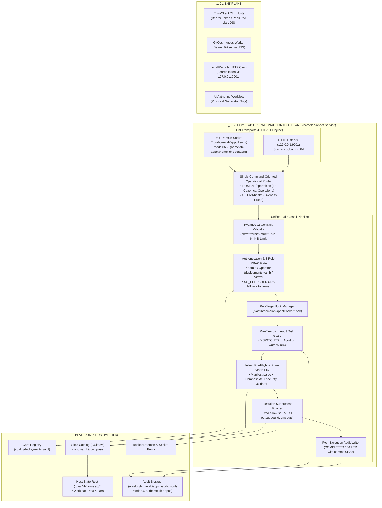

# Architecture Consolidation & Control Plane Roadmap v6

> **Supersedes**: [Architecture Consolidation & Control Plane Roadmap v5](architecture-consolidation-roadmap-v5.md)
>
> **Authoritative Repository Specifications**:
> - Core Readiness Plan: `~/Homelab/Core/docs/plans/p4-readiness-plan.md`
> - Core Roadmap Projection: `~/Homelab/Core/ROADMAP.md`
>
> **Architectural Decision Records**:
> - [`homelab-appctl-control-plane-architecture.md`](../../../03-records/decisions/homelab-appctl-control-plane-architecture.md) (`~/Homelab/Core/docs/decisions/0002-appctl-control-plane-architecture.md`)
> - [`homelab-3tier-architecture-and-provenance.md`](../../../03-records/decisions/homelab-3tier-architecture-and-provenance.md) (`~/Homelab/Core/docs/decisions/0001-3tier-architecture-and-provenance.md`)
> - `~/Homelab/Core/docs/decisions/0003-pydantic-v2-runtime-validation.md`
>
> **Evolutionary History**:
> - [`homelab-control-plane-evolution-v1-to-v6.md`](../../../04-learning/knowledge/methods/homelab-control-plane-evolution-v1-to-v6.md)
>
> **Target System**: `roadtotech.me` (NixOS appliance `Core/`, application workloads `Sites/`, persistent state `~/var/lib/homelab/`)

---

## Executive Summary

Roadmap v6 codifies the transition of `appctl` into an authoritative, fail-closed **Operational Control Plane Daemon** (`homelab-appctl.service`). It incorporates the architectural reconciliation and locked decisions (**`DEC-01` through `DEC-05`**) finalized before initiating the Milestone P4 daemon implementation.

Under Roadmap v6, `appctl` completely abandons its legacy identity as a collection of local Bash scripts directly invoking `docker compose` and `git`. Instead:
1. **One Logical API Across Dual Transports**: A unified HTTP/1.1 engine serving both a local Unix Domain Socket (`/run/homelab/appctl.sock`) and loopback TCP (`127.0.0.1:9001`) with zero protocol divergence.
2. **Single Canonical Operation Router**: Operations dispatch via a single, strictly-typed command endpoint (`POST /v1/operations` + `GET /v1/health`), eliminating multi-route REST ambiguity.
3. **Host Access Does Not Confer Mutation Authority**: Entering via SSH provides Unix access, but zero operational control plane privileges. Every mutating action and sensitive read (`workload.config`, `workload.logs`) requires a cryptographically verified, SOPS-projected SHA-256 Bearer token.
4. **Dedicated Systemd Service Identity & Privilege Isolation**: The daemon executes as `homelab-appctl` (`Group = "homelab-operators"`), isolated from operator shell processes and AI coding sessions, protected by declarative POSIX ACLs.
5. **Unified Pre-Flight & Pure-Python Environment Assembly**: Shell `source` and `eval` are eliminated; environments are parsed via inert Python readers, and every mutation is gated by Compose AST security validation.
6. **Append-Only Audit Log with Fail-Closed Disk Guard**: Multi-dimensional telemetry (`audit.jsonl`, mode `0600`) records pre-execution (`DISPATCHED`), post-execution (`COMPLETED`/`FAILED`), and admission rejection (`DENIED`) records. If the audit log cannot be written, the mutation is aborted before any Docker or Git subprocess executes.

---

## 1. System Topology & Control Plane Architecture

---

## 2. Core Architectural Invariants (Codified DEC-01 through DEC-05)

1. **One Logical API Across Transports (`DEC-01`)**:
   - The API is a single logical HTTP/1.1 contract served over Unix domain socket (`/run/homelab/appctl.sock`) and TCP (`127.0.0.1:9001`).
   - All operations are dispatched through `POST /v1/operations` with JSON payloads (`version: "1.0"`). Convenience liveness is exposed via `GET /v1/health`. Multi-route REST aliases (`GET /workloads`, `POST /operations/deploy`) are rejected.
2. **Host Access Does Not Confer Mutation Authority (`DEC-02`)**:
   - SSH entry confers zero control plane mutation authority. Every mutating operation and sensitive read (`workload.config`, `workload.logs`) strictly requires a valid Bearer token (`/run/secrets/appctl/tokens.json`).
   - Local UDS connections without Bearer tokens leverage `SO_PEERCRED` to identify the caller and fall back strictly to `homelab-viewer` privileges for non-sensitive reads (`list`, `get`, `resolve`, `ssl`, `health`).
3. **Dedicated Service Identity & OS Boundary (`DEC-03`)**:
   - The daemon runs as `homelab-appctl` (`Group = "homelab-operators"`).
   - Unprivileged processes and AI agents running under the operator SSH session cannot access `/run/secrets/appctl/tokens.json` (`0400`) or mutate `/var/log/homelab/appctl/audit.jsonl` (`0600`).
   - Declarative `systemd.tmpfiles.rules` apply recursive default POSIX ACLs (`d:u:homelab-appctl:rwx,u:homelab-appctl:rwx`) to shared directories.
4. **GitOps Ingress Unification (`DEC-04`)**:
   - `scripts/gitops_dispatcher.py` retains webhook ingress, HMAC verification, `config/deployments.yaml` admission, and the asynchronous `.pending.json` queue.
   - The background worker delegates execution to the daemon's `workload.update` operation over the Unix domain socket, eliminating duplicated `git pull` and `docker compose` execution paths.
5. **Unified Pre-Flight & Pure-Python Environment Assembly (`DEC-05`)**:
   - Shell `source` and `eval` are eliminated. Subprocess environments are assembled entirely in Python with strict key validation against `ENV_KEY_RE` and `RESERVED_ENV_KEYS`.
   - Every mutating Compose operation is preceded by `validate_compose_security()`, enforcing AST security constraints across both CLI and GitOps paths.
6. **Append-Only Audit Log with Fail-Closed Disk Guard (`DEC-03`)**:
   - Mutating operations append a `DISPATCHED` record before touching Docker or Git. If the disk write fails, the request immediately terminates with `500 ERR_EXECUTION_FAILED`.
7. **Git is the Authoritative Source of Deployment State**:
   - Approved `DeploymentModels` are committed to Git. `appctl` reconciles desired Git state into running containers.
8. **Five-Stage Model Lifecycle (Intent vs. Implementation)**:
   - $\text{Repository} \xrightarrow{\text{Investigation}} \text{Application Profile} \xrightarrow{\text{Proposal}} \text{DeploymentProposal} \xrightarrow{\text{Human Selection}} \text{DeploymentModel (Git)} \xrightarrow{\text{appctl Materialize}} \text{Deployment Definition} \xrightarrow{\text{Reconcile}} \text{Containers}$.
9. **AI Authoring Boundary**:
   - AI agents are strictly upstream proposal generators (`DeploymentProposal`) with zero execution authority. Human operators approve the intent.
10. **Secret Reference Invariant & Clean Persistent State Root**:
    - Deployment definitions store secret references (`secretKeyRef`) resolved at runtime via `SecretProvider`, never plaintext credentials; mutable runtime data resides strictly under `~/var/lib/homelab/<app>/`, isolated from Git repositories.
11. **KISS Primitives & Linear Control Paths**:
    - Control flow remains strictly linear and local. No message brokers (RabbitMQ/Kafka) or deployment databases are introduced.

---

## 3. The 13 Canonical Domain Operations

| Domain Operation | Type | Required Role (`Sites` / `Core`) | Timeout | Subprocess / Engine |
| :--- | :--- | :--- | :--- | :--- |
| `workload.list` | Read-Only | `homelab-viewer` | `15s` | In-process (`appctl_engine.py`, `provenance.py`) |
| `workload.get` | Read-Only | `homelab-viewer` | `15s` | In-process (`appctl_engine.py`, `core_manifest.py`) |
| `workload.resolve` | Read-Only | `homelab-viewer` | In-process | In-process (`appctl_engine.py`) |
| `platform.ssl` | Read-Only | `homelab-viewer` | `3s` / host | In-process (`appctl_engine.py`) |
| `platform.health` | Read-Only | `homelab-viewer` | In-process | In-process daemon health probe |
| `workload.config` | Sensitive Read | `homelab-operator` / `homelab-admin`* | `15s` | `docker compose config` (secret redaction) |
| `workload.logs` | Sensitive Read | `homelab-operator` / `homelab-admin`* | `15s` | `docker compose logs --tail <1..1000>` |
| `workload.deploy` | Mutating | `homelab-operator` / `homelab-admin`* | `300s` | `docker compose up -d` $\to$ Homepage sync |
| `workload.stop` | Mutating | `homelab-operator` / `homelab-admin`* | `300s` | `docker compose down` / `stop` $\to$ Homepage sync |
| `workload.restart`| Mutating | `homelab-operator` / `homelab-admin`* | `300s` | `docker compose restart` $\to$ Homepage sync |
| `workload.pull` | Mutating | `homelab-operator` / `homelab-admin`* | `300s` | `docker compose pull` $\to$ `docker compose up -d` |
| `workload.update` | Mutating | `homelab-operator` / `homelab-admin`* | `60s` (git) `300s` (docker) | `git pull --ff-only` $\to$ Compose security validate $\to$ Declared actions $\to$ Homepage sync |
| `platform.sync_homepage` | Mutating | `homelab-operator` / `homelab-admin` | In-process | Compile `services.yaml` under `_homepage_sync.lock` |

*\*Targeting `core` or any `core_service` container strictly requires the `homelab-admin` role.*

---

## 4. Phased Implementation Roadmap

### Overview

| Milestone | Title | Focus Area | Status | Deliverables Summary |
| :--- | :--- | :--- | :--- | :--- |
| **P0** | **Baseline Consolidation** | Git & Architecture | ✅ **Completed** | Synchronized `refactor/appctl-rework` with `main`, recorded control plane ADR, modernized metadata engine. |
| **P1** | **Mail Realignment** | Topology & State | ✅ **Completed** | Moved Stalwart to `smtp.<domain>`, migrated SnappyMail to `~/Sites/snappymail` with zero data loss. |
| **P2** | **GitOps Hardening** | Ingress Security | ✅ **Completed** | Authoritative Core registry (`deployments.yaml`), Compose AST validator, systemd sandboxing. |
| **P3** | **Manifest Contract** | Domain Engine | ✅ **Completed** | Schema v1.0 with Pydantic v2 models (`core_manifest.py`), two-axis inspection, unified `appctl_engine.py`. |
| **P4** | **Control Plane Daemon** | API & Dispatch | 🎯 **Current / Up Next** | `homelab-appctl.service`, dual transport (socket + HTTP), single router, mandatory auth, thin-client CLI, audit log. |
| **P5** | **Identity & Secrets** | Auth & Providers | ⏳ **Planned** | LLDAP RBAC mapping, Authelia ForwardAuth headers, user-scoped token lifecycle, `SecretProvider` reference resolution. |
| **P6** | **Deployment Model & AI**| Intent Authoring | ⏳ **Planned** | Platform capability catalog, `DeploymentProposal` $\to$ `DeploymentModel` compiler, Git commit pipeline. |
| **P7** | **Operations UI & Portal** | Client Integration | ⏳ **Planned** | Dedicated Operations UI client, live log streaming (SSE), Homepage read-only status integration. |

---

### Milestone P0: Baseline Consolidation (Completed)
- Merged `refactor/appctl-rework` and `main` into a unified architectural baseline.
- Modernized metadata engine with strongly-typed models (`SitesApp`, `CoreService`, `SourceConfig`).
- Formalized control plane ADR (`homelab-appctl-control-plane-architecture.md`).
- Verified test harness (`./scripts/test`) and Nix flake sandbox.

---

### Milestone P1: Mail Topology Realignment & Zero-Data-Loss Migration (Completed)
- Executed timestamped, SHA256-verified backup of SnappyMail data.
- Provisioned Class B Image-Only workload at `~/Sites/snappymail/` and state root at `~/var/lib/homelab/snappymail/`.
- Replicated state with byte parity verification (`diff -r`).
- Re-homed Stalwart public endpoint to `smtp.<domain>` and removed SnappyMail from Core stack.
- Verified webmail logins, address book persistence, and Diun SMTPS alert delivery on port 465.

---

### Milestone P2: GitOps Privilege & Authority Hardening (Completed)
- Established `Core/config/deployments.yaml` as sole authority for admitted GitOps deployment repositories.
- Decoupled `~/Brain` data vault from workload continuous deployment.
- Implemented Compose AST security validator rejecting `privileged: true`, Docker socket binds, and host namespace escapes.
- Sandboxed `homelab-gitops.service` with `ProtectSystem=strict`, `NoNewPrivileges=true`, and private temporary directories.

---

### Milestone P3: Manifest Contract Convergence & Provenance Engine (Completed)
- Released Schema v1.0 with fail-closed Pydantic v2 validation (`core_manifest.py`).
- Implemented two-axis inspection: local checkout state (`✓ Synced`, `* Dirty`) vs upstream software provenance (`git ls-remote` with 10s timeout).
- Promoted unified engine to `scripts/appctl_engine.py`, retired `appctl_engine_v2.py` shim, and achieved zero Pyright warnings.

---

### Milestone P4: Appctl Control Plane Daemon & Command-Oriented API (Current / Up Next)
**Status**: 🎯 **Approved & Locked (Pre-P4 Security Gate Complete; Ready for Daemon Implementation)**

Implementation is divided into six dependency-ordered slices:
1. **Slice 1 — Pydantic v2 API Contracts & Error Sanitizer (`scripts/appctl_contracts.py`)**:
   - Strict request/response/error/audit models (`ConfigDict(extra="forbid", strict=True)`), 64 KiB request limit, and input-sanitized error mapping (`include_input=False`).
   - Add `"compose_pull"` to `ALLOWED_ACTIONS` in `scripts/core_manifest.py`.
2. **Slice 2 — Append-Only Audit Logger & Per-Target Lock Manager**:
   - `AuditLogger` supporting `DISPATCHED`, `COMPLETED`, `FAILED`, `DENIED`, mode `0600`, secret redaction, and fail-closed disk guard.
   - Non-blocking `fcntl.flock` manager for `/var/lib/homelab/appctl/locks/<target>.lock` and `_homepage_sync.lock`.
3. **Slice 3 — Authentication & 3-Role RBAC Gate**:
   - SOPS `tokens.json` SHA-256 authenticator (`hmac.compare_digest`), UDS `SO_PEERCRED` fallback for viewer reads, and role-scoped authorization (`homelab-admin`, `homelab-operator` scoped to `deployments.yaml`, `homelab-viewer`).
4. **Slice 4 — Operational Router & Unified Execution Engine**:
   - Pure-Python `.env` parser (no shell `source`), mandatory pre-flight checks, revision-consistent `workload.update`, bounded `workload.logs` (`tail` 1..1000), and atomic Homepage sync.
5. **Slice 5 — Dual-Transport HTTP/1.1 Daemon (`scripts/appctl_daemon.py`) & GitOps Cutover**:
   - HTTP/1.1 server over `/run/homelab/appctl.sock` and `127.0.0.1:9001` with graceful signal handling.
   - Rewire `scripts/gitops_dispatcher.py` worker to invoke `POST /v1/operations` (`workload.update`) over the Unix domain socket.
6. **Slice 6 — Thin-Client CLI (`scripts/appctl`), NixOS Service & Genericism Cleanup**:
   - Re-implement `scripts/appctl` as thin UDS HTTP client.
   - Declare `homelab-appctl.service` (`homelab-appctl:homelab-operators` + POSIX ACLs) in `nixos/modules/homeserver.nix`.
   - Scrub remaining hardcoded domain/user literals and add `pyright` to `flake.nix` and pre-commit hooks.

---

### Milestone P5: Identity, RBAC & SecretProvider Interface (Planned)
- Plug Traefik/Authelia trusted ForwardAuth headers (`Remote-User`, `Remote-Groups`) with dedicated proxy authentication.
- Implement dynamic LLDAP user-scoped API token lifecycle.
- Implement `SecretProvider` interface resolving `secretKeyRef` references at container runtime without Git history pollution.

---

### Milestone P6: Homelab Deployment Model & AI Authoring Workflow (Planned)
- Machine-readable Platform Capability Catalog defining Core capabilities and security invariants.
- `DeploymentProposal` schema for AI-assisted service discovery.
- Operator approval Git pipeline: `DeploymentProposal` $\to$ committed `DeploymentModel` $\to$ `appctl` materialization.
- Human-in-the-loop approval invariant strictly enforced (AI has 0 execution authority).

---

### Milestone P7: Operations UI & Dashboard Integration (Planned)
- Dedicated lightweight web console consuming the `appctl` API for proposal review, approval, real-time log streaming (SSE), and token management.
- Homepage read-only status integration widgets querying `appctl` live status endpoints.

---

## 5. Definition of Done & Quality Gates

1. **Unified Control Plane**: All platform operations execute through `homelab-appctl.service`. No secondary deployment scripts exist.
2. **Explicit Authentication Everywhere**: Host SSH access does not confer appctl mutation authority. Every mutating request presents an authenticated Bearer token.
3. **Transport Equivalence**: Hermetic test suite asserts 100% schema and status parity between UDS and HTTP listeners.
4. **Declarative Git Truth**: All workloads are governed by version-controlled definitions in Git.
5. **Secret Hygiene**: Zero plaintext credentials in deployment manifests; secrets resolve via tmpfs and dynamic providers.
6. **Safe Deployment Authoring**: AI agents act strictly as proposal generators; all mutations require human approval.
7. **Zero Production Regressions**: Platform migrations include pre-flight snapshots, state parity proofs, and documented rollback procedures.
8. **Automated Verification**: Every commit must pass `./scripts/test` (Ruff linter + Pytest suite + Pyright type checker + Nix flake check).
