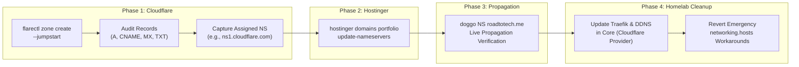

# Dynu → Cloudflare Authoritative DNS Cutover Action Plan

This plan details the authoritative DNS migration for `roadtotech.me` from Dynu to Cloudflare using the declarative CLI tooling (`flarectl`, `hostinger`, `doggo`) and in-memory SOPS secret wrappers configured on your workstation.

---

## Architecture & Operational Invariants



### Critical Invariants
1. **The "Grey Cloud" (DNS-Only) Rule**: All homelab records (`roadtotech.me`, `*.roadtotech.me`, `mail.roadtotech.me`) must have Cloudflare proxying **disabled** (`--proxy=false`). Cloudflare’s HTTP proxy does not route non-HTTP traffic (Gitea SSH on port `2223`) and intercepts direct Let's Encrypt TLS handshakes.
2. **Transactional Mail Preservation**: Brevo verification TXT codes and SnappyMail MX records must be present in Cloudflare before nameserver cutover to ensure zero email disruption.
3. **In-Memory Credential Safety**: Invoking `flarectl` and `hostinger` through your shell wrappers (`home/shell/secrets.sh`) injects credentials directly into child process memory via `sops -d --extract`. Never pipe or write decrypted tokens to disk.

---

## Execution Phases

### Phase 1: Cloudflare Zone Setup & Record Audit (`flarectl`)

#### 1.1 Create the Zone with Automatic Crawling
Run `flarectl zone create` with `--jumpstart` so Cloudflare automatically queries public DNS and imports active records:

```bash
flarectl zone create --zone roadtotech.me --jumpstart
```

*Expected Output*: Returns a table displaying the new **Zone ID** and the **Name Servers** assigned to your domain (e.g., `ns1.cloudflare.com`, `ns2.cloudflare.com`). Note these two nameservers for Phase 2.

#### 1.2 Audit Crawled DNS Records
Verify that Cloudflare discovered the existing records:

```bash
flarectl dns list --zone roadtotech.me
```

#### 1.3 Ensure Required Homelab & Mail Records Exist
Compare the output against the required homelab record set. If any record was missed during the jumpstart crawl (e.g. because Dynu was timing out), create it explicitly:

| Name | Type | Target Content | Proxy State | Purpose | CLI Creation Command (if missing) |
| :--- | :---: | :--- | :---: | :--- | :--- |
| `@` | `A` | `186.112.11.188` | **DNS Only** | Apex domain pointing to homelab WAN IP | `flarectl dns create --zone roadtotech.me --name roadtotech.me --type A --content 186.112.11.188 --proxy=false` |
| `*` | `CNAME` | `roadtotech.me` | **DNS Only** | Wildcard routing for all Sites behind Traefik | `flarectl dns create --zone roadtotech.me --name "*" --type CNAME --content roadtotech.me --proxy=false` |
| `mail` | `A` | `186.112.11.188` | **DNS Only** | SnappyMail webmail endpoint | `flarectl dns create --zone roadtotech.me --name mail.roadtotech.me --type A --content 186.112.11.188 --proxy=false` |
| `@` | `MX` | `mail.roadtotech.me` | N/A | Inbound mail routing (Priority 10) | `flarectl dns create --zone roadtotech.me --name roadtotech.me --type MX --content mail.roadtotech.me --priority 10` |
| `@` | `TXT` | `brevo-code:0509c2a6d12137c59d9e6b7fbef9fe8d` | N/A | Brevo outbound domain authentication | `flarectl dns create --zone roadtotech.me --name roadtotech.me --type TXT --content "brevo-code:0509c2a6d12137c59d9e6b7fbef9fe8d"` |
| `_dmarc` | `TXT` | `v=DMARC1; p=none; rua=mailto:rua@dmarc.brevo.com` | N/A | DMARC email security policy | `flarectl dns create --zone roadtotech.me --name _dmarc.roadtotech.me --type TXT --content "v=DMARC1; p=none; rua=mailto:rua@dmarc.brevo.com"` |

---

## Phase 2: Hostinger Nameserver Cutover (`hostinger`)

Once the Cloudflare zone is populated with all records, update the registrar delegation at Hostinger.

#### 2.1 Inspect Current Delegation
Verify your domain's current nameserver registration:

```bash
hostinger domains portfolio get roadtotech.me
```

#### 2.2 Update Nameservers to Cloudflare
Replace `<ns1>` and `<ns2>` with the exact nameservers assigned by Cloudflare in Step 1.1:

```bash
hostinger domains portfolio update-nameservers roadtotech.me \
  --ns1 <assigned-ns-1>.ns.cloudflare.com \
  --ns2 <assigned-ns-2>.ns.cloudflare.com
```

*Expected Output*: Returns `Status: OK` confirming that custom nameservers were submitted to the registry.

---

## Phase 3: Propagation Verification (`doggo`)

Root TLD nameserver updates typically take between 2 to 15 minutes to reflect across global recursive caches.

#### 3.1 Verify Authoritative Nameserver Cutover
Query the parent `.me` nameservers directly to confirm the registrar published the new delegation:

```bash
# Query root authoritative DNS
doggo NS roadtotech.me @1.1.1.1
doggo NS roadtotech.me @8.8.8.8
```
*Verification Check*: Output should list the two Cloudflare nameservers instead of `ns*.dynu.com`.

#### 3.2 Verify Public Hostname Resolution
Check that public resolvers return your homelab's current WAN IP (`186.112.11.188`):

```bash
# Verify apex, Gitea, and mail endpoints
doggo roadtotech.me @1.1.1.1
doggo gitea.roadtotech.me @1.1.1.1
doggo mail.roadtotech.me @1.1.1.1
```
*Verification Check*: Returns `186.112.11.188` with a low TTL (~300s).

---

## Phase 4: Homelab Core Refactor & Cleanup

Once public DNS is fully answering from Cloudflare, we bring the homelab appliance into permanent alignment:

#### 4.1 Update Traefik ACME Challenge Provider (`Core`)
In `~/Homelab/Core/docker-compose.yml`:
* Replace `--certificatesresolvers.myresolver.acme.dnschallenge.provider=dynu` with `cloudflare`.
* Update the environment projection in `nixos/modules/homeserver.nix` to inject `CF_DNS_API_TOKEN` instead of `DYNU_API_KEY`.

#### 4.2 Replace Dynu Monitor with Cloudflare DDNS
* Decommission `dynu-monitor.service` and `dynu-monitor.timer`.
* Configure `ddclient` (or a dedicated Cloudflare API updater unit) to update Cloudflare's A record when the WAN IP rotates.

#### 4.3 Revert Emergency Workarounds
* **Laptop (`~/Config`)**:
  ```bash
  git -C ~/Config checkout main
  sudo nixos-rebuild switch --flake ~/Config#laptop
  git -C ~/Config branch -D chore/dynu-outage-workaround
  ```
* **Server (`~/Homelab/Core`)**:
  ```bash
  git -C ~/Homelab/Core checkout main
  git -C ~/Homelab/Core branch -D fix/server-loopback-dns
  ```
