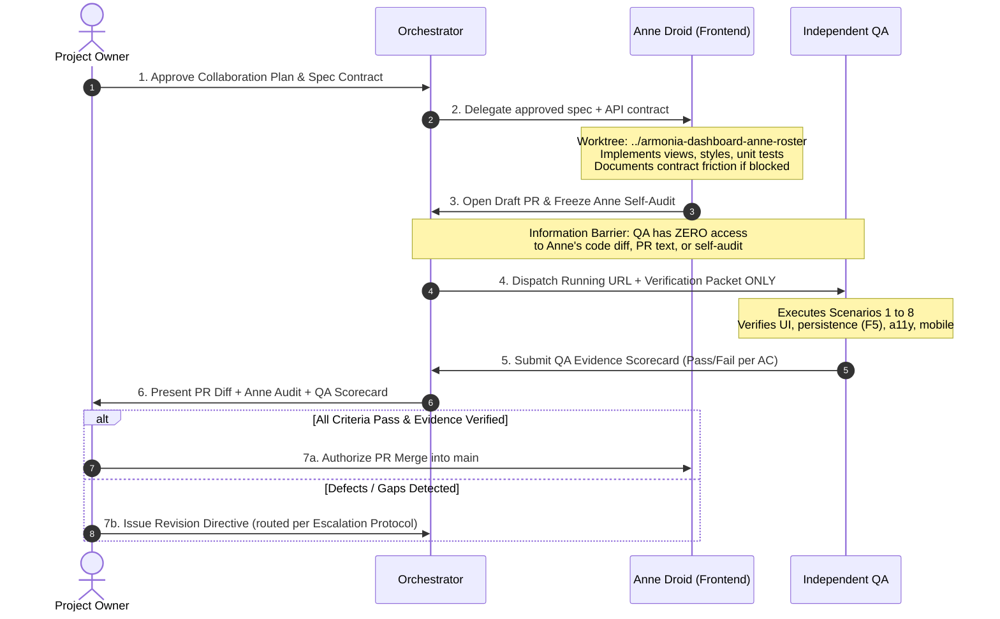
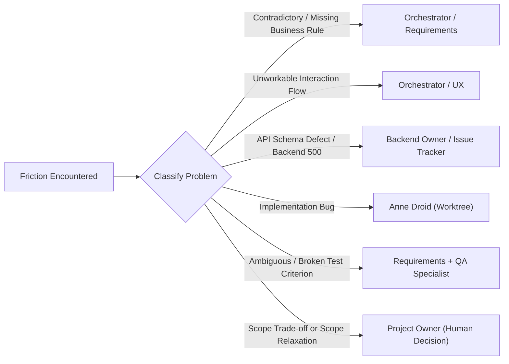

# Project Collaboration Plan: Group Workshop Roster Pilot

> **Status:** Draft Working Plan (Under Owner Review)  
> **Target System:** `armonia-dashboard`  
> **Pilot Simplification Note:** For this pilot, the Orchestrator synthesizes both the requirements and the UX proposal. This is a deliberate pilot simplification to test the workflow without premature agent proliferation; it does **not** demonstrate that Requirements Engineering and UX Design are interchangeable in the permanent agency architecture.

---

## 1. Active Role Roster & Authority Boundaries

| Role                          | Operational Scope for This Pilot                                                                              | Autonomous Authority                                                        | Strict Boundary / Prohibited                                                                     |
| :---------------------------- | :------------------------------------------------------------------------------------------------------------ | :-------------------------------------------------------------------------- | :----------------------------------------------------------------------------------------------- |
| **Project Owner**             | Final business authority, requirement sign-off, risk acceptance, conflict adjudication, and release approval. | All consequential product and architectural decisions.                      | N/A                                                                                              |
| **Orchestrator**              | Synthesizes specification; monitors handoffs; verifies precondition gates; routes escalation friction.        | Workflow sequencing, contract packaging, QA test dispatching.               | **Cannot** modify acceptance criteria, relax invariants, waive QA defects, or approve PR merges. |
| **Anne Droid (Frontend)**     | Implements frontend views, styles, and component tests against the approved contract.                         | Component modularity, state architecture, styling tokens, local unit tests, implementation decomposition, and commit sequencing. | **Cannot** commit to `main`, modify business logic, silently mock API endpoints, merge PRs, or **modify/refactor existing working features outside the assigned scope**. |
| **Independent QA Specialist** | Validates running application against acceptance criteria using the Verification Packet.                      | Pass/Fail/Blocked verdicts per criterion backed by browser evidence.        | **Cannot** waive acceptance criteria, inspect Anne's code/self-audit, or make release decisions. |

### 1.1 Scope Containment & Non-Regression Invariant
When tasked with implementing a new feature (Feature C, e.g. Workshop Roster):
1. **Preserve Existing Capabilities**: Existing views and features (Features A and B: Follow-up Queue, Daily Agenda, Client Directory, Nueva Cita modal) must continue to function without behavioral, visual, or test regressions. All existing test suites (`pnpm exec vp test`) must pass 100%.
2. **Beyond Automated Tests (Targeted Workflow Checks)**: Because existing automated tests may not cover every edge in Queue or Agenda, Anne's self-audit must execute targeted smoke checks of those existing workflows (e.g. verifying that the 48h queue loads and the Nueva Cita modal still opens without errors).
3. **Additive Isolation & Justified Integration**: Feature C must reside in dedicated, isolated files (e.g., `src/components/WorkshopRoster.ts`). Edits to shared integration points (`main.ts`, `api.ts`, `types.ts`, `style.css`) should be strictly additive by default. If an unavoidable non-additive integration edit is required, Anne must document and justify it in her frozen self-audit.
4. **No Opportunistic Refactoring**: Anne is strictly prohibited from rewriting, reorganizing, or reformatting existing working components unless explicitly instructed by the Specification Contract.
5. **Self-Audit Regression Gate**: Anne's frozen self-audit must explicitly prove that existing tabs still render correctly and that the git diff is tightly bounded to the assigned feature.

### 1.2 Incremental Implementation & Commit Discipline
Anne Droid owns the decomposition of the approved feature specification into coherent implementation increments. The Project Owner defines the required outcomes and acceptance criteria; the Orchestrator does not prescribe the implementation task sequence unless a specific dependency, risk, or contract constraint requires intervention.

1. **Engineer-Owned Decomposition**: Before writing code, Anne identifies a practical sequence of implementation increments based on the approved contract and existing architecture. The sequence is an engineering breakdown, not a source of new product requirements. Missing requirements or consequential scope changes must be escalated rather than resolved through implementation planning alone.
2. **Coherent Incremental Commits**: Anne commits completed increments as work progresses. Each commit must have a clear purpose, a reviewable diff, and a Conventional Commit message describing the change (e.g., `feat(roster): add API client and roster types`, `feat(roster): implement session card and capacity indicators`). Commits must reflect genuine progress rather than arbitrary file boundaries or retrospective subdivision of a completed feature.
3. **Intermediate Integrity**: Each commit should leave the branch in a coherent state and pass the checks relevant to its changes (`pnpm exec biome check .`, `vp check`). The completed feature must pass the full required test suite. Any temporary intermediate limitation must be intentional, documented in commit notes, and resolved before the PR is submitted for review.
4. **Scope and Regression Boundaries**: Incremental commits do not authorize opportunistic refactoring or unrelated behavior changes. Changes to existing features and shared integration points remain subject to the Scope Containment & Non-Regression Invariant.
5. **Traceability and Review**: Anne's frozen self-audit must summarize the implementation increments, map commits to acceptance criteria, explain any justified deviations from the initial breakdown, and document any known limitations. The Orchestrator may flag incoherent commits, excessive unrelated changes, or gaps in traceability, but may not dictate implementation details solely to enforce a preferred task sequence.
6. **Integrated Verification**: Commit-level checks do not replace feature-level acceptance testing or independent QA. The complete pull request remains subject to the approved Specification Contract, Verification Packet, regression requirements, and Project Owner's release decision.

### 1.3 Clarification on QA Failure Routing & Final Acceptance
- **QA owns its findings and supporting evidence**, not the release decision.
- If QA reports a failure on an acceptance criterion, the Orchestrator routes the defect back to Anne (for an implementation bug) or to the relevant specialist (for an API or requirement flaw).
- **The Orchestrator cannot waive a failure or convert a failed acceptance criterion into a pass.** Only the Project Owner has the authority to relax a requirement, accept a known risk, or authorize a PR merge.

---

## 2. Phase-by-Phase Handoff Matrix

| Phase                                 | Acting Role                                | Required Input                               | Produced Output                                              | Approval Gatekeeper                               |
| :------------------------------------ | :----------------------------------------- | :------------------------------------------- | :----------------------------------------------------------- | :------------------------------------------------ |
| **Phase 1: Operating Model**          | Orchestrator                               | Pre-experiment baseline snapshot             | `COLLABORATION-PLAN.md`                                      | **Project Owner** (Signs off on roles)            |
| **Phase 2: Contract Formulation**     | Orchestrator (Requirements + UX synthesis) | API schema, M4 roadmap scope                 | `SPEC-WORKSHOP-ROSTER.md` + `VERIFICATION-PACKET-ROSTER.md`  | **Project Owner** (Approves criteria & test data) |
| **Phase 3: Implementation**           | Anne Droid                                 | Approved spec + running API                  | `feat/anne/workshop-roster` PR + frozen `anne-self-audit.md` | **Anne Droid** (Freezes self-audit prior to QA)   |
| **Phase 4: Independent Verification** | QA Specialist                              | Running build URL + Verification Packet ONLY | `qa-evidence-scorecard.md`                                   | **QA Specialist** (Signs off on test evidence)    |
| **Phase 5: Release & Post-Mortem**    | Project Owner                              | PR diff + Anne Audit + QA Scorecard          | Merge decision + Pilot evaluation log                        | **Project Owner** (Decides merge / rework)        |

---

## 3. Explicit Change & Escalation Protocol

If any specialist encounters a blocking condition or contradiction, work halts at that boundary and routes strictly according to problem type:

1. **API Friction Rule**: Anne must record a structured **Contract Friction Notice** on the PR rather than silently creating synthetic mock data or changing expected response shapes.
2. **Owner Escalation Rule**: Any trade-off affecting user workflows (e.g. omitting walk-in check-ins due to API constraints) requires an explicit choice from the Project Owner.
