# Specification Contract: Group Workshop Roster Quick Check-in

> **Contract Authority:** Binding implementation contract for `armonia-dashboard`.  
> **Engineering Boundary:** This specification defines *what* the operator must accomplish and *how* states behave. The component breakdown, DOM composition, and styling implementation belong to Anne Droid's engineering judgment. Implementation must be strictly additive and isolated; existing features (Follow-up Queue, Daily Agenda, Client Directory, Nueva Cita) must remain undisturbed and 100% passing.

---

## 1. Domain Context & User Goals

In Armonía del Ser, group services (e.g., *Círculo de Cacao Presencial*, *Meditación con Cuencos*) take place with multiple attendees (up to 12–25 capacity).

**The Operator's Goal:**
On the day of the workshop, Jasmin or her assistant stands at reception. As participants arrive, the operator needs a mobile-first, high-density view to:
1. Confirm which group workshop session is active today and review capacity metrics.
2. Rapidly record digital attendance (1-tap check-in marking attendance and completing the booking).
3. Identify payment state at a glance: identify who is pre-paid (`PAGADO` via SPEI) versus who must pay on arrival (`PENDIENTE`).
4. Collect cash on-site and acknowledge payment in the same 1-tap check-in action.
5. Register and check in unexpected walk-in attendees without disrupting the session flow.

---

## 2. Precise Semantic Definitions & Status Mapping

### 2.1 The Two Workshop Counters

```
┌────────────────────────────────────────────────────────────────────────┐
│                        Workshop Counter Semantics                      │
├─────────────────────┬──────────────────────────────────────────────────┤
│ Metric              │ Business Meaning & Mutation Rules                │
├─────────────────────┼──────────────────────────────────────────────────┤
│ occupied_count      │ Total participants holding an active spot        │
│                     │ (status: RESERVED, COMPLETED, NO_SHOW).          │
│                     │ • Advance booking created: count increments.     │
│                     │ • Existing attendee checks in: count UNCHANGED.  │
│                     │ • Walk-in attendee registers: count increments.  │
├─────────────────────┼──────────────────────────────────────────────────┤
│ attended_count      │ Participants physically present & verified       │
│                     │ (booking_status: COMPLETED, attended: true).     │
│                     │ • Existing attendee checks in: count increments. │
│                     │ • Walk-in attendee registers: count increments.  │
└─────────────────────┴──────────────────────────────────────────────────┘
```

- **Capacity Display**: Formatted as `Ocupación: {occupied_count} / {max_capacity} ({attended_count} presentes)`.
- **409 Conflict Disambiguation & Reconciliation Contract**:
  The backend issues `HTTP 409 Conflict` in two distinct business scenarios, which the client must differentiate by inspecting `response.detail`:
  1. *Already Checked-In Conflict (`detail` indicates attendee already checked in)*: Indicates an idempotent duplicate submission. The client must reconcile by updating the attendee row to `ASISTIÓ`, disabling the check-in button, and showing an informative status toast (*"El asistente ya contaba con asistencia registrada"*). The client must never crash or treat this as a failed/unregistered state.
  2. *Capacity Exceeded Conflict (`detail` indicates cupo máximo / capacity reached)*: Occurs during walk-in registration when `occupied_count >= max_capacity`. The client must display an explicit capacity error alert (*"El taller ha alcanzado su cupo máximo (X)"*), keep the modal form state intact for operator decision, and **never** optimistically increment attendance or report success.
- **Ordinary Network / 500 Failure**: Preserve the current UI state, do not change attendee status, and allow the operator to retry.

### 2.2 Status Terminology Mapping Table

To prevent ambiguity between UI labels and backend persistence, all badge renderings must adhere to this mapping:

| UI Badge / Label | Visual Styling | Backend Entity | Persisted Status Field & Value |
| :--- | :--- | :--- | :--- |
| **`REGISTRADO`** | Slate/Neutral Pill | `Booking` | `booking_status: "RESERVED"`, `attended: false` |
| **`ASISTIÓ`** | Emerald/Green Pill | `Booking` | `booking_status: "COMPLETED"`, `attended: true` |
| **`PAGADO`** | Emerald/Green Pill | `Booking` & `Payment` | `payment_status: "ACKNOWLEDGED"` |
| **`PENDIENTE`** | Amber/Orange Pill | `Booking` | `payment_status: "AWAITING_ACKNOWLEDGMENT"` |

---

## 3. Resilient Error-Recovery Contract (The 5 States)

Every interactive view in this feature must explicitly handle the 5 states:

```mermaid
stateDiagram
    [*] --> Loading: Switch to #rosters tab
    Loading --> Empty: GET /rosters returns []
    Loading --> Error_Roster: GET /rosters fails (Network/500)
    Loading --> Roster_Ready: GET /rosters returns sessions
    
    Error_Roster --> Loading: Tap "Reintentar"
    Empty --> Loading: Change date picker
    
    Roster_Ready --> Action_In_Flight: Tap Check-in or Submit Walk-in
    Action_In_Flight --> Action_Error: POST fails (Timeout/Network)
    Action_In_Flight --> Roster_Ready: POST succeeds (HTTP 200) -> Toast
    Action_Error --> Roster_Ready: Toast error; row stays uncommitted
```



1. **Loading State**: Render skeleton placeholder cards for workshop sessions and attendee rows. Layout shift (CLS) must remain $\le 0.05$.
2. **Empty State**: If no group sessions exist for the selected date, display:
   > *"No hay talleres grupales programados para esta fecha."*  
   The date selector remains interactive so the operator can navigate to adjacent days.
3. **Failed Roster Retrieval (Error with Retry)**: If `GET /rosters` fails (network down or server error), display an inline error banner:
   > *"No se pudieron cargar los talleres. Verifica tu conexión."*  
   Accompanied by an explicit `<button class="btn btn-secondary">Reintentar</button>` that re-triggers the fetch without a full page reload.
4. **Action Failure & Conflict Recovery**:
   - *Already-Checked-In Conflict (409)*: If the server reports the attendee is already checked in, the client reconciles state by updating the row to `ASISTIÓ`, disabling check-in, and displaying an informative notice (*"El asistente ya contaba con asistencia registrada"*).
   - *Capacity Reached Conflict (409)*: If a walk-in is rejected because the session is full, the client reports the capacity limit (*"El taller ha alcanzado su cupo máximo"*), leaves the form open for operator decision, and does not record attendance.
   - *Network / Server Error (5xx / Timeout)*: The client displays an accessible error toast, preserves the uncommitted attendee row state (no optimistic toggle), and keeps the action button enabled for immediate retry.
5. **Success Feedback State**: Upon successful check-in or walk-in:
   - Immediate visual feedback on the row (`ASISTIÓ` badge).
   - Display an accessible toast container equipped with `role="status"` and `aria-live="polite"` announcing: *"Asistencia registrada con éxito."*

---

## 4. Explicit Acceptance Criteria (AC)

### `AC-1`: Workshop Session Selection & Capacity Overview
- **Given** the operator navigates to the "Talleres" tab (URL hash `#rosters`),
- **When** the view loads for the selected date (default: today),
- **Then** it queries `GET /rosters?date_from=YYYY-MM-DD&date_to=YYYY-MM-DD`.
- **And** it displays the group session title, scheduled time, and a capacity counter formatted as `Ocupación: {occupied_count} / {max_capacity} ({attended_count} presentes)`.

### `AC-2`: Attendee Roster Display & Status Indicators
- **Given** an active workshop session with registered attendees,
- **When** the session roster renders,
- **Then** each attendee row displays: Client Name, Phone, Booking Code (`ADS-XXXX`), Attendance Status (`REGISTRADO` vs. `ASISTIÓ`), and Payment Status (`PAGADO` vs. `PENDIENTE`).
- **And** includes a 1-tap `wa.me` link pre-populated with the attendee's phone.

### `AC-3`: Existing Booking Check-in (Pre-paid)
- **Given** an attendee with `booking_status: "RESERVED"` and `payment_status: "ACKNOWLEDGED"`,
- **When** the operator taps the "Registrar Asistencia" button,
- **Then** the client sends `POST /rosters/quick-checkin` with payload `{"booking_id": "<id>", "paid_cash": false}`.
- **And** upon HTTP 200, the row immediately updates to `ASISTIÓ`, the check-in button disables, and `attended_count` increments by 1.

### `AC-4`: Existing Booking Check-in with Cash Payment Acknowledgment
- **Given** an attendee with `payment_status: "AWAITING_ACKNOWLEDGMENT"`,
- **When** the operator taps check-in with "Cobro en efectivo recibido" checked,
- **Then** the client sends `POST /rosters/quick-checkin` with payload `{"booking_id": "<id>", "paid_cash": true, "notes": "Cobro en puerta"}`.
- **And** upon HTTP 200, the row reflects both `ASISTIÓ` and `PAGADO` (`ACKNOWLEDGED`), and `attended_count` increments by 1 without full page reload.

### `AC-5`: Walk-in Attendee Quick Registration & Check-in
- **Given** an unregistered participant arrives at the workshop,
- **When** the operator taps "＋ Registrar Asistente Sin Cita",
- **Then** a modal opens requesting: Full Name, Phone (WhatsApp), and Cash Payment toggle (defaults to `true` / checked, because walk-in reception is predominantly cash).
- **When** submitted, the client sends `POST /rosters/quick-checkin` with Mode 2 payload:
  `{"service_id": "<id>", "scheduled_at": "<iso>", "client_name": "...", "client_phone": "...", "paid_cash": true}`.
- **And** upon HTTP 200, the modal closes, the attendee appears in the list as `ASISTIÓ` and `PAGADO`, and both `occupied_count` and `attended_count` increment by 1.
- **And** the modal submit button disables while in flight to prevent accidental double-click duplicate registrations.

### `AC-6`: Resilient Error Handling & Retry
- **Given** an error state (failed roster fetch or interrupted check-in),
- **Then** the UI exposes an actionable retry path without clearing existing form data or falsely marking attendees present.

### `AC-7`: Mobile Ergonomics & Keyboard Accessibility
- All interactive controls (Check-in buttons, Cash toggles, Walk-in trigger, Modal inputs) must have touch targets of at least **44x44px**.
- Roster rows must render cleanly at **375px** viewport width without horizontal scroll overflow.
- All interactive controls must support sequential keyboard focus (`Tab` / `Shift+Tab`) with visible `:focus-visible` outlines.
- Toast feedback must announce to assistive technology via `role="status"` and `aria-live="polite"`.

---
## 5. Navigation & Architectural Conventions

1. **Tab Identifier**: `rosters`
2. **URL Hash**: `#rosters`
3. **Navigation Label**: "Talleres"
4. **Header Integration**: Integrated into `OperatorDashboardApp.renderShell()` in `src/main.ts` alongside `#queue`, `#agenda`, `#clients`, and `#all`.
5. **Cash Toggle Default**: In the walk-in modal, the "Cobro en efectivo recibido" toggle defaults to **checked (`true`)**. *Rationale:* In-person workshop walk-ins overwhelmingly settle entrance fees in cash at reception. Operators may uncheck if the client provides immediate SPEI transfer verification.

---

## 6. API Contract Reference

The view interacts strictly with existing endpoints defined in `armonia-api`:

- **Endpoint 1:** `GET /rosters?date_from={YYYY-MM-DD}&date_to={YYYY-MM-DD}&service_id={optional}`
  - *Response Shape:* `list[RosterSessionRead]` (see `app/schemas/roster.py`).
- **Endpoint 2:** `POST /rosters/quick-checkin`
  - *Mode 1 (Existing Booking):*
    ```json
    { "booking_id": "uuid-str", "paid_cash": true, "notes": "Opcional" }
    ```
  - *Mode 2 (Walk-In):*
    ```json
    {
      "service_id": "uuid-str",
      "scheduled_at": "2026-10-25T18:00:00Z",
      "client_name": "Nombre Cliente",
      "client_phone": "525512345678",
      "paid_cash": true
    }
    ```
  - *Response:* `QuickCheckinResponse` (`walk_in: bool`, `attendee: RosterAttendeeRead`).
  - *Conflict Behavior:* HTTP 409 Conflict if attendee already completed or session at max capacity.
