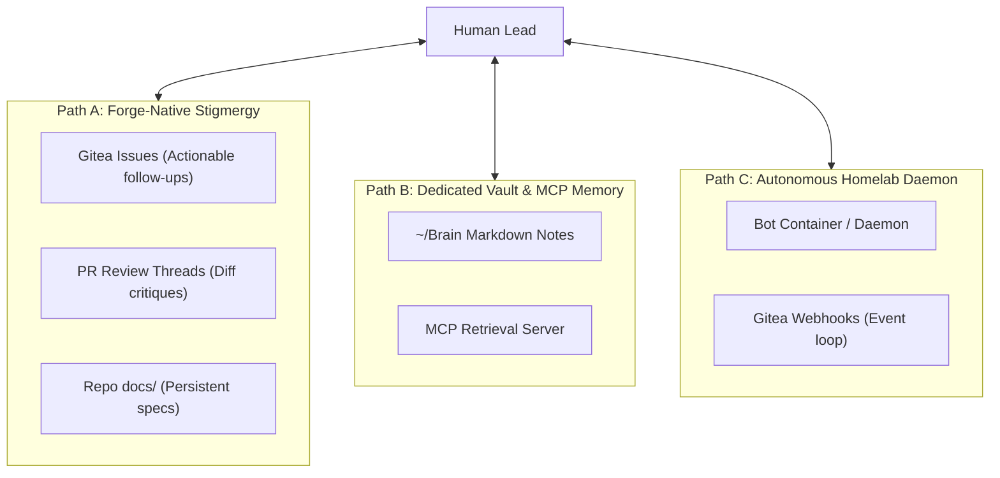

# Architectural Discussion: Agent Persistence, Asynchronous Coordination, and Memory Horizons

## 1. Problem Statement & Historical Context

Pair-programming with specialized, autonomous subagents (such as Anne Droid, a frontend and UX specialist) initially highlighted a fundamental friction: **agent ephemerality and memory boundary amnesia**.

While Anne successfully executed branch-level tasks, generated commits under her own Gitea forge identity (`anne-droid`), and opened Pull Requests via the `tea` CLI, her operational lifespan remained bound to individual interactive sessions. Once an execution session terminated or the conversation context was compacted, the agent's intermediate reasoning, active follow-ups, and architectural inquiries evaporated.

During the `type-hints` frontend integration, the agent drafted architectural inquiries and schema questions regarding backend API endpoints (such as coordinate reporting in AST validation errors). In an interactive session, these inquiries were captured in ephemeral chat transcripts or scratchpads. This posed a central dilemma:
* If follow-up questions remain in temporary chat buffers, future agent invocations start from zero, requiring manual reconstruction of history and consuming scarce context tokens.
* If questions are committed directly to repository code branches as unorganized notes, they pollute the project's source tree with transient conversational noise.

The challenge was to design a durable, low-friction mechanism for cross-session continuity and asynchronous coordination that reflects real-world engineering team practices without drowning in cognitive or infrastructural maintenance overhead.

---

## 2. Context & Analysis: Core Dilemmas

### Biological Stigmergy vs. Human Engineering Parallels

The problem of ephemeral memory is not unique to language models. Biological systems solve coordination across ephemeral individuals through **stigmergy**: agents modify their external physical environment (e.g. pheromone trails or extracellular matrices), allowing subsequent agents to respond to environmental state rather than requiring direct inter-agent memory transfer.

Human engineering teams operate under an identical dynamic. Individual engineers experience context switches, sleep cycles, vacations, and project reassignments. Teams prevent collapse not by maintaining infinite shared biological memory, but by externalizing coordination into durable, shared forge artifacts:

1. **Session-Level Context**: Active terminal buffers, working reasoning, intermediate diffs (lifespan: minutes to hours).
2. **Task & Review Level (Actionable Ephemera)**: Pull Request reviews, inline diff comments, and discrete forge issues (lifespan: days to weeks). Once answered or merged, they are closed.
3. **Persistent System Documentation**: Architecture Decision Records (ADRs), interface contracts, design tokens, and domain models (lifespan: permanent).
4. **Cross-Project Persona & Tastes**: Design system standards, anti-"zombie UI" manifestos, and stack preferences that persist across repositories.

Conflating these distinct memory horizons causes either severe context bloat (stuffing raw conversational history into prompt context) or repository decay (filling issues with trivial questions or cluttering `docs/` with one-off operational notes).

---

## 3. Evaluated Dilemmas & Rejected Alternatives

Three architectural models were evaluated to bridge agent memory and asynchronous collaboration:

### Option A: Forge-Native Asynchronous Stigmergy (Gitea + `tea` CLI)

* **Mechanism**: Leverage the existing self-hosted Gitea forge as the single source of truth. Anne reads and creates Gitea Issues and PR comments via the `tea` CLI. Follow-up inquiries are filed as discrete issues with high-threshold criteria, while permanent architectural contracts live in repository `docs/`.
* **Trade-off Evaluation**:
  - *Strengths*: Reuses existing infrastructure with zero added operational cost. Naturally matches human software development workflows. Persists context directly alongside the codebase with clear audit trails.
  - *Frictions*: Does not provide automated background execution; the human lead still triggers session invocations.

### Option B: Dedicated Agent Brain & MCP Memory Retrieval

* **Mechanism**: Maintain dedicated agent journals and project state files within the `~/Brain` knowledge vault, queried dynamically by agents via a custom Model Context Protocol (MCP) server.
* **Trade-off Evaluation**:
  - *Strengths*: Enables cross-repository persona persistence and centralized query capabilities.
  - *Reasons Set Aside*: Experience revealed that maintaining customized MCP schemas, metadata synchronization, and indexing pipelines introduces significant maintenance drag. Stored notes risk semantic drift whenever code evolves independently of the vault.

### Option C: The Autonomous Homelab Daemon (Containerized Event-Driven Bot)

* **Mechanism**: Deploy the agent as a standalone background container or systemd service on the homelab network, listening to Gitea webhooks (e.g. `@anne-droid` mentions, PR review comments) to trigger autonomous worktree checkouts, test runs, and commit responses.
* **Trade-off Evaluation**:
  - *Strengths*: Achieves true asynchronous team collaboration where the agent responds in Gitea without requiring an active IDE pairing session.
  - *Reasons Parked*: Introduces significant systems complexity (webhook routing, security sandboxing, containerized git permissions) and presents risk of runaway token consumption or infinite execution loops if event boundaries fail.

---

## 4. What Became Possible After the Epistemic Separation

By decoupling **actionable one-time inquiries** from **persistent repository documentation**, clear rules for agent communication emerged:

| Information Horizon | Target Destination | Lifespan & Lifecycle | Threshold Filter |
| :--- | :--- | :--- | :--- |
| **Persistent Design & System Contracts** | Repository `docs/` or component trees | Permanent; updated via PRs | High-frequency reference: component tokens, UX state machines, API contracts. |
| **Actionable Single-Response Tasks** | Gitea Issues (`tea issues create`) | Ephemeral; closed upon resolution | High-bar trigger: breaking contract changes, security/auth boundaries, severe client UX/performance degradation. |
| **In-Line Diff Feedback** | PR Review Threads (`tea pulls comment`) | Ephemeral; resolved upon merge | Minor ergonomic notes or line-specific questions tied strictly to active diff. |
| **Transient Session Reasoning** | Antigravity ephemeral context | Ephemeral; discarded at turn end | Internal implementation scratchpad and intermediate CLI outputs. |

This epistemic separation prevents repository issue trackers from degrading into noisy chat logs while ensuring critical interface friction is never lost between sessions.

---

## 5. Convergence & Successors

The exploration converged on:
1. **Immediate Execution (Path A)**: Adopting forge-native coordination. Updating Anne Droid's operational contract to establish clear triage criteria for when to create repository documentation versus when to open a Gitea issue.
2. **Parking Long-Term Automation (Path C)**: Retaining the autonomous containerized daemon concept as a candidate for future homelab development once forge-native interaction patterns are proven and mature.
3. **Successors**:
   - Updated agent specification in `profile/agents/anne-droid.md`.
   - Dogfooding issue triage during backend/frontend contract negotiations in `type-hints`.
