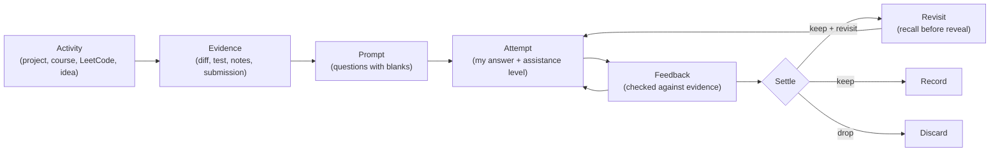

# Architectural Discussion: A Learning-Centered Engineering Workflow

## 1. Problem Statement & Purpose

The objective is to turn the daily engineering work I already do into **engineering competence I can retrieve and use later**, without slowing the work down so much that I stop using the system.

**Success test:** six months from now I can:
1. Recover what I did and why,
2. Explain or apply what I learned *without rereading*, and
3. See honestly what I don't know yet.

### Non-Goals
- Producing complete, polished documentation of all activity.
- Measuring "skill level" with a numeric score.
- Getting better at prompting.

---

## 2. Requirements Analysis

Sorted by provenance. Only R-items bind the design. I-items are exploratory ideas.

### Stated Requirements (Binding)

| ID | Requirement |
| :--- | :--- |
| **R1** | The record must bring back things I'd forget: a concept studied months ago, why an architecture was chosen, what was built in a given week. |
| **R2** | Artifacts must be worth rereading. Polish and structure are not value. |
| **R3** | Content value over metadata. Frontmatter is minimal. |
| **R4** | For learning-worthy work, the AI drafts **questions and blanks** around key concepts. I complete them. |
| **R5** | A curation step checks my answers against the evidence and gives feedback. |
| **R6** | For commits, the AI points at key details. I write the message and choose the integration strategy. |
| **R7** | The AI helps me do the cognitive work. It does not do it for me (active recall, active learning, practice). |
| **R8** | Productivity sometimes wins. There has to be a low-friction path (delivery mode). |
| **R9** | The target is architecture, problem solving, and engineering judgment. |
| **R10**| Design choices rest on cognitive science and instructional design, because that makes the design sound, not to decorate it with citations. |
| **R11**| Must cover four activities: project work, courses (Coursera/Platzi), daily LeetCode, planning/ideas. |
| **R12**| Must weave in: retrieval, spacing, formative feedback, git discipline, TDD, invariants, architecture reasoning, separating facts from interpretation. |

### Exploratory Ideas

| ID | Idea | Status |
| :--- | :--- | :--- |
| **I1** | REST/MCP service recording commits, goals, artifacts, concepts | Deferred to §10 |
| **I2** | PostgreSQL as an event queue, with listeners deriving records | Deferred to §10 |
| **I3** | Hartman proficiency ladder as the progress model | Evaluated as lens only; unverified primary source |

---

## 3. Theoretical Basis & Design Principles

Each row pairs research findings with system principles and testable predictions:

| Finding | Design Principle | Testable Prediction |
| :--- | :--- | :--- |
| **Generation effect** (Slamecka & Graf, 1978): information produced by oneself is remembered better than information read. | **P1: I write the core reasoning.** The AI supplies facts and questions, not answers. | Notes I wrote are easier to recall later than AI-written ones. |
| **Retrieval practice / testing effect** (Roediger & Karpicke, 2006; Dunlosky et al., 2013): recalling beats rereading for long-term retention. | **P2: Revisits are recall attempts.** I answer before seeing the old note. | Revisit accuracy improves over successive attempts. |
| **Spacing and successive relearning** (Cepeda et al., 2006; Rawson & Dunlosky): spread-out retrieval sessions build durable memory. | **P3: Selected items come back after growing gaps.** | Items revisited 2–3 times stay recallable. Ones never revisited fade. |
| **Feedback** (Hattie & Timperley, 2007): feedback works when it targets the gap and the next step, not when it praises. | **P4: Feedback is diagnostic.** Correct / missing / wrong / unsupported, then revise. Never "masterfully". | I revise answers after feedback, and later attempts show fewer repeated gaps. |
| **Fluency illusion** (Bjork, Dunlosky & Kornell, 2013): smooth, easy-to-read material makes people overestimate what they know. | **P5: The polished AI summary is a known hazard.** This explains the "AI slop" feeling. | Reading a polished journal feels productive, but recall afterwards is weak. |
| **Self-explanation** (Chi et al., 1989): explaining *why* each step works deepens understanding. | **P6: Questions ask why and what-if,** not "what is X". | Why/what-if answers predict transfer better than definitions do. |
| **Desirable difficulties** (Bjork, 1994): struggle helps learning, but only if it's within reach. | **P7: Hints escalate gradually,** smallest useful hint first. | Hint level needed for the same concept drops over time. |
| **Expertise reversal** (Kalyuga et al., 2003): scaffolds that help novices get in the way once you know the material. | **P8: Scaffolding fades per concept.** Familiar ground goes to delivery mode (R8). | Forcing questions on routine work causes rubber-stamping. |
| **Deliberate practice** (Ericsson et al., 1993): focused practice at the edge of ability, with feedback. | **P9: Pick a few targets.** Not every commit is a lesson. | A few chosen capabilities improve more than "learn from everything". |
| **Transfer** (near vs far): applying a principle in a new context is harder than recall and means more. | **P10: The strongest evidence is a changed-context challenge.** | Demonstrating transfer in projects proves retention. |

**Progress models** (Dreyfus novice→expert; Hartman ladder): useful vocabulary for *describing* growth, but neither is a validated measurement scale. The system does not encode a ladder as state; it records evidence and lets the human judge.

---

## 4. Core Conceptual Model

- **Evidence** is an objective fact: a commit SHA, test result, accepted submission, or course section.
- **Prompt** is AI-generated: a few questions drawn directly from that evidence, with blanks.
- **Attempt** is learner-produced, tagged with `independent | hints | substantial | shown-solution`.
- **Feedback** compares the attempt with the evidence and diagnoses gaps.
- **Settle** is the human call: keep, keep and revisit, or discard.
- **Revisit** is a delayed recall attempt on the prompt or a changed-context variant.

---

## 5. Mode Separation: Delivery vs. Learning

| Dimension | Delivery Mode | Learning Mode |
| :--- | :--- | :--- |
| **Primary Goal** | Get the work done efficiently | Build a specific, durable capability |
| **AI Role** | Drafts, messages, summaries | Facts, evidence, and questions only |
| **Learner Role** | Reviews and approves | Writes reasoning, explanations, commit messages |
| **Output Record** | Facts only (what, when, links) | Facts + learner attempt + diagnostic feedback |
| **Appropriate Context** | Routine work, tight deadlines, familiar stacks | New concepts, real decisions, hard bugs, chosen targets |

---

## 6. Activity Adapters

1. **Project Work (decisions $\to$ features $\to$ commits)**:
   - *Before*: In learning mode, state requirement, invariant, and failing test.
   - *At commit*: AI lists diff slices and factual changes; learner writes message; AI checks against diff.
   - *Integration*: Learner chooses merge/rebase/cherry-pick with rationale.
2. **Courses**:
   - *Before*: One line predicting what the concept means.
   - *During*: Sparse notes in own words, marking confusions with `?`.
   - *After*: Source closed, explain the core idea; AI diagnoses gaps.
3. **LeetCode**:
   - Attempt first unaided.
   - Stuck $\to$ hint ladder; assistance level recorded.
   - After acceptance: Write why the loop invariant/property works.
4. **Planning and Ideas**:
   - Captured as a hypothesis (trigger, assumptions, falsifying evidence, next test).

---

## 7. System Invariants

1. **AI never writes reasoning in learning mode.** Facts and questions only.
2. **Evidence $\neq$ assessment.** A commit, passing test, or completed module is never recorded as proof of competence.
3. **Assistance level is always recorded** (`independent`, `hints`, `substantial`, `shown-solution`).
4. **Gaps stay visible.** Unanswered prompts remain blank or marked `open`.
5. **Facts and interpretations are kept apart**, as are learner words and AI words.
6. **Revisits are selective** with explicit human opt-in (`revisit_after: YYYY-MM-DD`).
7. **Every kept artifact passes the 30-second reread test.**

---

## 8. Resolution & Successors

This design discussion informed:
- The [Learning Contract](https://github.com/kiskaadee/skills/blob/main/profile/learning-contract.md) governing skills (`practice`, `git-commit`, `document`, `journal-builder`).
- The phased execution plan: [`01-plans/brain/learning-contract-and-scaffolded-skills.md`](../../01-plans/brain/learning-contract-and-scaffolded-skills.md).
