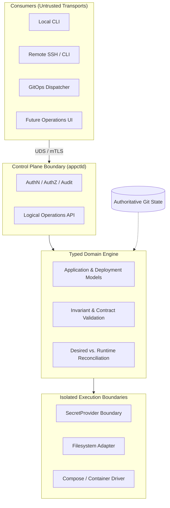

# Architectural Discussion: Homelab Control Plane Modernization & Separation of Responsibilities

## 1. Problem Statement & Historical Context

The `roadtotech.me` homelab historically managed service operations through `appctl`—a local operational harness composed of a Bash wrapper (`scripts/appctl`) and a Python metadata discovery script (`scripts/appctl_engine.py`). Commands such as `up`, `down`, `restart`, `update`, `logs`, and `sync` were invoked directly on the server host, sourcing environment files and credentials from `/run/secrets/`.

### Why the Legacy Model Looked Attractive
In the early stages of the platform, this hybrid model appeared pragmatic and low-friction:
- **Immediate Feedback**: Bash provided rapid subprocess orchestration (`docker compose`), while Python handled parsing of manifests (`app.yaml`) and Docker inspection data.
- **Minimal Abstraction**: Running commands directly against the local Docker socket and filesystem avoided the overhead of maintaining a persistent background daemon, network listeners, or client-server protocols.
- **Convenient Secret Access**: Sourcing `/run/secrets/` directly inside shell scripts made database passwords and API tokens instantly available to Docker commands without writing custom secret resolution layers.

### Concrete Operational Failures & Friction Points
As the homelab expanded to host complex multi-tier services, automated GitOps webhooks, and rigorous linting/testing pipelines, the ad-hoc model exhibited severe architectural strain:
1. **Behavioral Drift Across Entry Points**: Different operational consumers—the local developer shell, remote SSH invocations, and the `gitops_dispatcher.py` webhook handler—implemented their own orchestration logic and assumptions. A deployment triggered by a Git webhook could behave differently from the same deployment executed interactively via the CLI.
2. **Entangled Failure Modes**: When a deployment failed, diagnosing the root cause required tracing execution across shell functions, subprocess calls, environment variable inheritance, and process exit codes. It was frequently unclear whether a failure stemmed from invalid manifest YAML, missing runtime secrets, Docker daemon errors, or bash string-splitting quirks.
3. **Fragile Testing Ergonomics**: Because domain rules (such as identity matching or deployment validation) were intertwined with shell execution, testing a simple business constraint required running against a live host with an active Docker daemon and populated secrets on disk.

---

## 2. Context & Analysis: The Mixing of Responsibilities

The central architectural breakdown in the legacy model was that **too many distinct responsibilities were mixed together**: domain decisions, process orchestration, operating system execution, and secret access were spread indiscriminately across Python and Bash scripts.

Modernization is fundamentally about establishing clear, enforceable boundaries between these responsibilities rather than replacing Bash with Python or adding abstractions for their own sake.

### The Role and Limits of a Daemon
Introducing a daemon (`appctld`) does not automatically eliminate operational or security liabilities. Rather, a daemon provides **a single, central place where consistent contracts, authorization rules, auditing, and testing can be enforced**. Without a daemon, every client or script must re-implement and re-verify these guarantees independently.

### Transport Access vs. Application Authority
A critical conceptual error in the legacy setup was confusing host access with application authority:
- Sockets and SSH provide *transport reach*—a secure pipe to reach the machine or process.
- Transport access should **not** automatically grant permission to deploy, modify, or tear down workloads managed by the platform.

Having SSH access to the appliance host or permission to connect to a Unix domain socket at `/run/homelab/appctl.sock` answers only whether a process can communicate with the host. It does not answer whether that principal is authorized to perform a specific mutating operation on an application. The control plane must decouple transport from authorization, evaluating explicit policies and generating immutable audit logs.

### The Real Liability of Secret Handling
Sourcing files from `/run/secrets/` is not inherently insecure; the filesystem location itself is not the flaw. The real liability is **how broadly secrets propagate and how difficult it is to enforce least privilege**:
- Sourcing a broad secrets file into a shell environment loads sensitive credentials into the parent process environment.
- Any child subprocess, debugging trace (`set -x`), environment dump, or logging utility can inadvertently leak those values.
- A script executing a routine container restart may end up with ambient access to credentials for completely unrelated databases.

The required architectural boundary is a dedicated `SecretProvider`. Deployment definitions should contain *references* to secrets rather than raw values, and the domain engine should resolve only the specific credentials required by a targeted workload at the exact moment of execution.

### Types vs. Runtime Verification
A typed domain engine replaces untyped dictionaries and string parsing with validated domain models (e.g. applications, identities, deployment states). This allows invalid inputs to be rejected at the boundary before touching Docker or the filesystem.

However, types do not guarantee correctness or eliminate the need for testing. Types express invariants and allow consistent enforcement, but they cannot replace integration tests for authentication, socket file permissions, secret protection, or recovery from network/filesystem faults.

---

## 3. Evaluated Dilemmas & Rejected Alternatives

### Option A: Hardening the Procedural Shell Scripts (Rejected)
* **Approach**: Retain the existing Bash scripts, but add strict linters (ShellCheck), defensive error traps (`set -euo pipefail`), and more verbose logging.
* **Why it fell short**: Shell scripts cannot represent rich domain models, cannot enforce typed contracts across boundary crossings, and cannot cleanly decouple secret propagation from child process environments. Furthermore, automated unit testing remains dependent on host mocks and subprocess fixtures.

### Option B: A Monolithic Python Client Executed Directly by Users (Rejected)
* **Approach**: Rewrite `appctl` entirely in Python as a single CLI tool that users run directly via `sudo` or as members of the `docker` group.
* **Why it fell short**: This retains client-owned execution. Each caller still runs with direct, privileged access to Docker and the filesystem. It fails to provide a uniform entry point for headless GitOps dispatchers, remote clients, and future UIs, and it leaves operational auditing scattered across individual invocation logs.

### Option C: Treating the Daemon as the Authoritative Source of Truth (Rejected)
* **Approach**: Allow the daemon to maintain its own mutable database of deployment configurations and desired state, which operators can update imperatively via API calls.
* **Why it fell short**: Git must remain the sole authoritative source of truth for desired deployment state. If the daemon or an interactive client can mutate the desired platform state independently of committed Git descriptors, the system loses reproducible deployments, review provenance, and disaster recovery guarantees. The daemon must reconcile *against* approved Git descriptors, never replace them.

---

## 4. What Became Possible After the Architectural Separation

| Architectural Dimension | Legacy Model (`scripts/appctl`) | Modernized Control Plane (`appctld` + Typed Engine) |
| :--- | :--- | :--- |
| **Responsibility Boundaries** | Mixed across Bash and Python scripts | Strictly separated: Control Plane $\rightarrow$ Domain Engine $\rightarrow$ Execution Adapters |
| **Client Execution** | Client-owned: each script or caller coordinates its own workflow | Centralized: all clients (local CLI, GitOps, UI) call one uniform operations API |
| **Authority Model** | Transport access (SSH/host access) conflated with application authority | Transport isolated; mutating actions require explicit authorization and structured audit |
| **Secret Scope** | Shell environment sourcing with wide subprocess inheritance | `SecretProvider` resolves specific secret references on demand for the target workload |
| **Testing Paradigm** | Required live Docker daemon, host filesystem, and populated secrets | Pure, isolated unit tests for domain models; focused integration tests for auth and runtime |
| **Authoritative State** | Split between Git checkouts, shell variables, and running containers | Git remains the sole authoritative source; daemon acts strictly as the reconciliation engine |

---

## 5. Convergence & Successors

The exploration converged on a clear architectural trajectory: **move operational authority out of scattered scripts and into one explicit, testable control plane (`appctld`) with a typed domain engine, while keeping desired state, authorization, secret access, domain decisions, and runtime execution strictly separated**.

This exploration informed the formal architectural commitments and implementation phasing recorded in:
- **Architectural Decision Record**: [`03-records/decisions/homelab-appctl-control-plane-architecture.md`](../../03-records/decisions/homelab-appctl-control-plane-architecture.md) — Formally adopts the daemon control plane, typed metadata engine, Unix domain socket transport, and `SecretProvider` boundary.
- **Implementation Roadmap**: [`01-plans/homelab/consolidation/architecture-consolidation-roadmap-v5.md`](../../01-plans/homelab/consolidation/architecture-consolidation-roadmap-v5.md) — Organizes the migration into concrete, incremental phases (P0 through P4).
