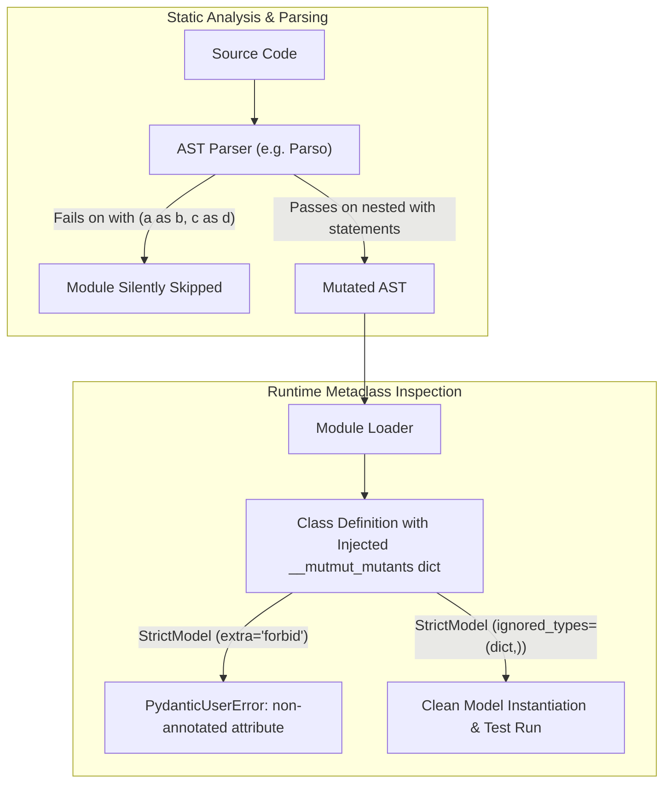

# AST Mutation Testing with Modern Python Syntax and Strict Models

## 1. The Practical Problem or Question

When evaluating the quality of a test suite, line coverage can be deceiving. A test can execute every line of a module without asserting the correctness of the operations performed. Mutation testing addresses this by programmatically generating point mutations in source code (inverting conditionals, altering boundary checks, stripping statements) and checking whether the existing test suite fails and catches the change.

In a modern Python codebase using Python 3.10+ syntax features and strict runtime schema enforcement (such as Pydantic v2 models with `extra="forbid"`), introducing an AST-level mutation tool like `mutmut` often breaks before any test even runs. The runner crashes or silently skips files, producing confusing errors or deceptive coverage statistics.

How do AST mutation engines interact with modern grammar and metaclass enforcement, and how can we write code that satisfies both strict runtime safety and dynamic mutation testing?

---

## 2. The Intuitive First Attempt and Why It Breaks

The intuitive workflow is straightforward: install the mutation runner, point it at the source directory, and run the test suite.

```bash
# Intuitive expectation: run mutmut and inspect killed mutants
mutmut run
```

In practice, this fails at two distinct boundaries:

### Failure Mode 1: The AST Parser Barrier
Most Python mutation tools do not execute against raw byte strings. They parse source code into an Abstract Syntax Tree (AST) using libraries like `parso`. 

Python 3.10 introduced parenthesized multi-context statements:
```python
with (
    socket.create_connection((domain, port), timeout=timeout) as sock,
    ctx.wrap_socket(sock, server_hostname=domain) as ssock,
):
    cert = ssock.getpeercert()
```

When an AST parser lacks full support for parenthesized statements containing `as` target assignments, it raises a syntax error. Rather than halting, mutation runners often log a warning and silently skip the entire module. The developer assumes the module has 100% mutation survival or that no mutants were possible, when in reality the module was never audited.

### Failure Mode 2: Strict Metaclass Rejection
To track and toggle mutations on the fly without repeatedly rewriting source files to disk, mutation frameworks inject mutant lookup structures directly into the runtime classes:

```python
# What the mutation engine injects at class definition time
class MyModel(BaseModel):
    xǁMyModelǁfield__mutmut_mutants = {"field": ...}
```

If the codebase uses Pydantic v2 models with strict schemas (`extra="forbid"`), Pydantic's model metaclass inspects every class-level attribute. When it finds the unannotated dictionary injected by the mutation runner, it immediately raises a `PydanticUserError`:

```text
pydantic.errors.PydanticUserError: A non-annotated attribute was detected:
xǁMyModelǁfield__mutmut_mutants = {...}
```

Tests that import or instantiate the models fail immediately during stats collection, halting the mutation run.

---

## 3. The Core Mental Model

AST mutation tools manipulate code syntax and class internals dynamically. Modern language features (Python 3.10+ parenthesized context managers) and strict metaclasses (Pydantic `extra="forbid"`) reject these tools unless syntax is parser-friendly and dynamic class attributes are explicitly ignored.



The friction arises because two systems have opposing goals:
- **Strict runtime modeling**: treats any unexpected class attribute or payload key as a security or typing defect.
- **Dynamic mutation tooling**: relies on injecting unannotated inspection attributes and rewriting ASTs in place.

Bridging them requires making our syntax parser-tolerant and configuring model metaclasses to ignore mutation harnesses.

---

## 4. Mechanism and Progressive Depth

### Rewriting Context Syntax for AST Parsers
Instead of using parenthesized multi-target context managers, use nested `with` blocks. Modern linters like Ruff may flag nested blocks under rule `SIM117`, which can be suppressed with an inline comment:

```python
# Ineffective: crashes older AST parsers in mutation engines
with (
    socket.create_connection((domain, port), timeout=timeout) as sock,
    ctx.wrap_socket(sock, server_hostname=domain) as ssock,
):
    raw_cert = ssock.getpeercert()

# Effective: cleanly parsed by all AST engines
with socket.create_connection((domain, port), timeout=timeout) as sock:  # noqa: SIM117
    with ctx.wrap_socket(sock, server_hostname=domain) as ssock:
        raw_cert = ssock.getpeercert()
```

### Allowing Mutation Harness Attributes in Strict Pydantic Models
Pydantic v2 provides a configuration setting specifically for class attributes that should bypass field parsing and schema validation: `ignored_types`.

By default, Python treats dynamic dictionaries attached to class definitions as class attributes. Adding `ignored_types = (dict,)` to base models tells Pydantic to ignore any bare dictionaries attached to the class namespace:

```python
# Ineffective: rejects mutation dictionary injection
class StrictModel(BaseModel):
    model_config = ConfigDict(extra="forbid", strict=True)

# Effective: preserves strict runtime data validation while ignoring mutation scaffolding
class StrictModel(BaseModel):
    model_config = ConfigDict(
        extra="forbid",
        strict=True,
        ignored_types=(dict,),
    )
```

This preserves the architectural invariant: user payloads with unexpected fields are still strictly rejected, while the testing engine's injected metadata passes without error.

### Authoritative Runner Configuration (`setup.cfg`)
Many modern Python projects consolidate configuration in `pyproject.toml`. However, tools like `mutmut` 3.x specifically look for `setup.cfg`. If configuration is only in `pyproject.toml`, the runner may fail with `FileNotFoundError: Could not figure out where the code to mutate is.`

Providing a standard `setup.cfg` anchors the configuration unambiguously:

```ini
[mutmut]
paths_to_mutate=scripts/
runner=pytest -x
also_copy=
    scripts
    config
    docker-compose.yml
```

---

## 5. The Mental Picture

Imagine an automated building inspector who measures every doorway using a rigid mechanical caliper.

- If you install a custom decorative doorframe with non-standard angles (parenthesized multi-context syntax), the caliper jams, and the inspector walks past the entire room without checking anything.
- When the inspector enters a room, they stick a temporary barcode sticker on every appliance (`__mutmut_mutants`). If the building has strict security guards (Pydantic metaclass) instructed to destroy anything unlabelled, the guards raise the alarm and lock down the building.

To let the inspection proceed, you use standardized doorway profiles that the mechanical caliper can read, and you give the security guards a rule: "Ignore barcode stickers on the machinery; focus on inspecting visitors entering the lobby."

---

## 6. The Trade-Offs and Costs

Making these accommodations involves small architectural and stylistic compromises:

1. **Slightly More Verbose Syntax**: Nested `with` blocks require an extra indentation level and an explicit linter override (`# noqa: SIM117`). In exchange, the codebase becomes compatible with a wider variety of static analysis and AST instrumentation tools.
2. **Loosened Class Namespace Checking**: Setting `ignored_types = (dict,)` means that if a developer accidentally assigns a class-level dictionary intended to be a typed field without a type annotation, Pydantic will ignore it rather than raising a configuration warning. Instance fields and runtime data payloads remain completely strict.
3. **Dual Configuration Files**: Maintaining `setup.cfg` alongside `pyproject.toml` introduces an additional configuration file until upstream tooling fully standardizes on PEP 518/621 configuration tables.

---

## 7. One Principle to Remember

When choosing between modern syntactic convenience and tooling interoperability:

> *Does this language construct or metaclass constraint allow external AST and introspection tools to analyze the code, or does it enforce purity at the expense of testability?*
