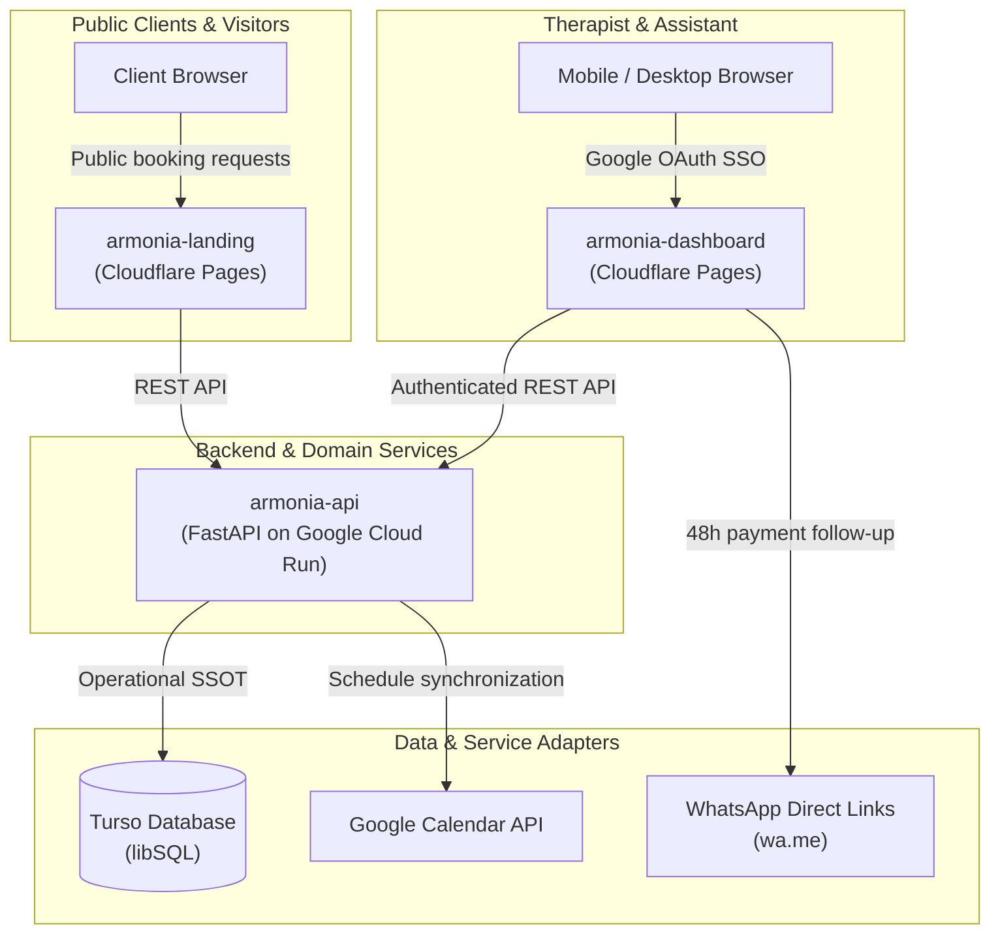

# 🌿 Armonía del Ser — Holistic Healing Center & Self-Service Booking Platform

**Armonía del Ser** (*Centro Holístico*, founded in 2007 by Jasmin Isaza in Tulancingo, Hidalgo, Mexico) is an alternative medicine and integrative health sanctuary offering psychological care, ancestral ceremonies (cacao circles, temazcales), quartz singing bowl sound meditations, Bach flower remedies, herbal medicine, and community workshops.

The digital ecosystem is a decoupled multi-repository architecture designed to transition 20 years of word-of-mouth client scheduling and manual WhatsApp administration into an automated self-service reservation and payment-tracking platform operating under a \$0 free-tier cloud budget.

---

## 🏛️ System Topology & Architecture

The ecosystem splits operational concerns into independent, decoupled repositories:

* **Client & Self-Service Portal (`armonia-landing`)**:
  - Public-facing discovery catalog, workshop schedules, and self-service reservation interface.
  - Bundled with Vite+, Tailwind CSS, and HTMX for responsive zero-framework client interactions.
  - Hosted on **Cloudflare Pages** (\$0 free tier).
* **Operator Control Surface (`armonia-dashboard`)**:
  - Mobile-first administration surface for Jasmin and her remote assistant.
  - Features a dedicated **48-hour follow-up queue**, payment verification modal, manual delayed-payment exception authorizer, attendee rosters, and multi-session package tracking.
  - Protected by Google OAuth2 and hosted on **Cloudflare Pages** (\$0 free tier).
* **Core Operational API & Domain Engine (`armonia-api`)**:
  - Asynchronous **FastAPI** service running on Python 3.13, packaged with `uv` and containerized via Docker.
  - Implements the **orthogonal booking and payment state machine**, mandatory session buffer collision detection, package redemption logic, and Google Calendar sync coordination.
  - Deployed to **Google Cloud Run** (\$0 free tier).
* **Persistence & Identity Layer**:
  - **Turso libSQL**: Embedded replica SQLite/libSQL database acting as the operational Single Source of Truth (SSOT).
  - **Google Calendar API**: External calendar adapter coordinating therapist availability, appointment sync health, and room bookings.
  - **Google OAuth2 + Turso Allowlist**: Role-based access control checking authenticated operator emails against the database allowlist.

---

## 📍 Source Code & Locations

| Component | Repository / Location | Target Platform | Stack & Tooling |
| :--- | :--- | :--- | :--- |
| **Workspace Org Hub** | [`armonia-del-ser`](https://gitea.roadtotech.me/armonia-del-ser) | Workstation: `~/Projects/active/armonia-del-ser` | Multi-repo management, roadmap, todo.txt |
| **Backend REST API** | [`armonia-api`](https://gitea.roadtotech.me/armonia-del-ser/armonia-api) | Google Cloud Run ($0 tier) | Python 3.13, uv, FastAPI, SQLModel, Turso libSQL |
| **Operator Dashboard** | [`armonia-dashboard`](https://gitea.roadtotech.me/armonia-del-ser/armonia-dashboard) | Cloudflare Pages ($0 tier) | Vite+, Tailwind CSS, HTMX, Biome |
| **Public Landing & Booking** | [`armonia-landing`](https://gitea.roadtotech.me/armonia-del-ser/armonia-landing) | Cloudflare Pages ($0 tier) | Vite+, Tailwind CSS, HTMX, Biome |
| **Local Homelab Gateway** | `armonia-homelab/` | Workstation / Edge Proxy | Traefik, local mock authentication |

---

## 🔑 Key Invariants & Architectural Commitments

1. **Orthogonal Booking and Payment State Engine**:
   - Booking lifecycle (`PENDING` -> `CONFIRMED` -> `COMPLETED` / `CANCELLED`) and Payment status (`UNPAID` -> `PENDING_VERIFICATION` -> `PAID` / `REFUNDED`) are decoupled orthogonal state machines.
   - An appointment can hold a confirmed reservation slot while its payment verification is pending manual review.

2. **Mandatory 1-on-1 Session Buffer Isolation**:
   - Individual therapy appointments strictly enforce pre- and post-session operational buffer times (e.g., room preparation, energetic cleansing, therapist transition).
   - Collision detection algorithms reject overlapping appointments within the combined window `[start - buffer_before, end + buffer_after]`.

3. **Multi-Session Package Tracking & Redemption**:
   - Pre-purchased session packages (e.g. 4-session therapy bundles) are tracked with transactional decrements upon appointment completion.
   - Redemption validation prevents ghost allocations and verifies package ownership before confirming slots.

4. **Zero-Cost Cloud Deployment Policy**:
   - All components are engineered within standard free tiers (Cloudflare Pages for static/HTMX frontends, Google Cloud Run with scale-to-zero for FastAPI, and Turso for serverless libSQL database storage).

5. **Human-in-the-Loop 48-Hour Payment Workflow**:
   - Accommodates Mexico's local cash transfer practices (SPEI / OXXO deposits).
   - Unverified bookings trigger automated alerts in the operator dashboard 48 hours prior to the session, enabling one-tap WhatsApp follow-ups (`wa.me`) before slots are forfeited.
