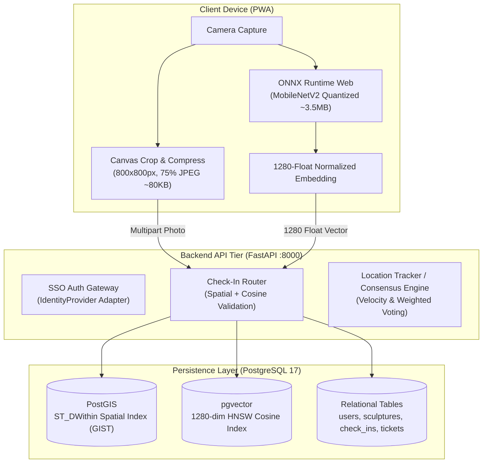

# 🐱 Novias del Gato — Digital Ecosystem for Cali's Public Art

**Novias del Gato** is an interactive geographic and cultural platform designed to track, catalog, and explore the iconic cat sculptures of Santiago de Cali, Colombia. Originating from Hernando Tejada's 1996 "El Gato del Río" (The River Cat) and expanded since 2006 with "Las Novias del Gato," the collection comprises 38 dynamic urban sculptures.

Because these monuments are frequently relocated for maintenance or urban planning, the platform acts as a **Geographic Cultural Oracle**, combining citizen crowdsourcing, trust reputation consensus, and client-side visual recognition to maintain a verified Single Source of Truth (SSOT).

---

## 🏛️ System Topology & Architecture

Novias del Gato uses a **Modular Monolith** and **API-First** architecture designed for low cloud hosting overhead and high cellular resilience:

* **Client & Edge Inference Tier**:
  - Progressive Web App (PWA) with camera integration and Leaflet map navigation.
  - **"Compressed Edge" Inference**: 8-bit quantized **MobileNetV2** runs locally in the user's browser via **ONNX Runtime Web** (WebAssembly/WebGL). The client extracts a 1280-dimension L2-normalized float embedding and compresses photos to ~80KB JPEGs (800x800px) before transmission.
* **Application & API Tier**:
  - Asynchronous **FastAPI** backend running on Python 3.14, packaged via `uv` with PEP 517/518 `src/` layout.
  - Fully decoupled authentication using an **SSO Identity Provider Adapter** pattern (`IdentityProvider` protocol).
  - Business logic implementing velocity filtering, spatial proximity verification, and crowdsourced weighted consensus.
* **Persistence & Spatial-Vector Tier**:
  - **PostgreSQL 17** containerized with both **PostGIS** (spatial) and **pgvector** (vector embeddings) extensions.
  - Spatial indexing (`GIST`) for 10-meter geographic proximity queries (EPSG:4326).
  - Vector indexing (`HNSW` with `vector_cosine_ops`) for sub-second similarity matching.



---

## 🔑 Core Invariants & Architectural Decision Records (ADRs)

1. **Zero Tensor Math on the Server (ADR-001)**:
   - Server runs on micro VPS instances without heavy ML frameworks (PyTorch/full ONNX), maintaining an idle footprint around ~80MB RAM.
2. **Separation of Check-in vs. Ticket**:
   - Check-ins validate physical exploration against the current SSOT.
   - Tickets report moved, missing, or altered sculptures without blocking explorer gameplay.
3. **Pluggable SSO Identity Provider Adapter**:
   - Core authentication depends on an abstract `IdentityProvider` contract (`verify_token(token: str) -> AuthUserIdentity`).
   - Supports `GoogleOAuthAdapter` in production and `MockDevAdapter` for offline local development and test automation.
4. **Hybrid Consensus Engine**:
   - **Velocity Checks**: Rejects teleportation/spoofing if calculated speed $v = \frac{\Delta d}{\Delta t} > 120\text{ km/h}$.
   - **Spatial Clustering**: Groups reports within a 20-meter radius over 48 hours.
   - **Confidence Scoring**: $C_{\text{cluster}} = \sum \text{trust\_score}_i$. Automatic promotion to SSOT occurs when $C_{\text{cluster}} \ge 3.0$ with $\ge 3$ distinct contributors. Conflicted or lower-confidence submissions escalate to manual moderator review.
   - **Reputation Dynamics**: Verified reports award $+0.05$ trust (max 1.0); malicious or invalid reports penalize $-0.15$.
5. **Cascade Triage & Non-Autoregressive Decision Engine (Jev)**:
   - Crowdsourced reports (`POST /reports`) and device fallback queues are triaged via a pluggable `TriageProvider` adapter (backed by TypeSafe AI's **Jev** model).
   - Fast evaluation against typed schemas (`choice` for intent/category, `noul` for spam detection, `score` for credibility) ensures sub-200ms latency, zero type errors, and calibrated probabilities without running heavy autoregressive LLMs.
   - Core mathematical velocity filters and client-side MobileNetV2 edge vectors remain untouched.

---

## 🗄️ Relational & Spatial Database Schema

```sql
-- Extensions
CREATE EXTENSION IF NOT EXISTS postgis;
CREATE EXTENSION IF NOT EXISTS vector;

-- Users (Explorers & Contributors)
CREATE TABLE users (
    id UUID PRIMARY KEY DEFAULT gen_random_uuid(),
    name VARCHAR(100) NOT NULL,
    email VARCHAR(255) UNIQUE NOT NULL,
    trust_score FLOAT NOT NULL DEFAULT 0.5 CHECK (trust_score >= 0.0 AND trust_score <= 1.0),
    created_at TIMESTAMP WITH TIME ZONE DEFAULT CURRENT_TIMESTAMP,
    updated_at TIMESTAMP WITH TIME ZONE DEFAULT CURRENT_TIMESTAMP
);

-- Sculptures (The Oracle SSOT)
CREATE TABLE sculptures (
    id UUID PRIMARY KEY DEFAULT gen_random_uuid(),
    name VARCHAR(255) NOT NULL,
    artist VARCHAR(255) NOT NULL,
    year INTEGER NOT NULL CHECK (year >= 1900),
    description TEXT,
    audio_url VARCHAR(512),
    unlocked_content TEXT,
    status VARCHAR(50) NOT NULL DEFAULT 'on-site' CHECK (status IN ('on-site', 'moved', 'missing')),
    location GEOGRAPHY(Point, 4326) NOT NULL,
    embedding vector(1280) NOT NULL,
    created_at TIMESTAMP WITH TIME ZONE DEFAULT CURRENT_TIMESTAMP,
    updated_at TIMESTAMP WITH TIME ZONE DEFAULT CURRENT_TIMESTAMP
);

-- Check-ins (Explorer Progress & Gallery)
CREATE TABLE check_ins (
    id UUID PRIMARY KEY DEFAULT gen_random_uuid(),
    user_id UUID NOT NULL REFERENCES users(id) ON DELETE CASCADE,
    sculpture_id UUID NOT NULL REFERENCES sculptures(id) ON DELETE CASCADE,
    captured_at TIMESTAMP WITH TIME ZONE NOT NULL,
    photo_url VARCHAR(512) NOT NULL,
    similarity_score FLOAT NOT NULL CHECK (similarity_score >= 0.0 AND similarity_score <= 1.0),
    created_at TIMESTAMP WITH TIME ZONE DEFAULT CURRENT_TIMESTAMP,
    CONSTRAINT uq_user_sculpture UNIQUE (user_id, sculpture_id)
);

-- Crowdsourced Tickets (Citizen Sighting Reports)
CREATE TABLE tickets (
    id UUID PRIMARY KEY DEFAULT gen_random_uuid(),
    reporter_id UUID NOT NULL REFERENCES users(id) ON DELETE CASCADE,
    sculpture_id UUID NOT NULL REFERENCES sculptures(id) ON DELETE CASCADE,
    reported_status VARCHAR(50) NOT NULL CHECK (reported_status IN ('on-site', 'moved', 'missing')),
    location GEOGRAPHY(Point, 4326) NOT NULL,
    photo_url VARCHAR(512),
    description VARCHAR(500),
    status VARCHAR(50) NOT NULL DEFAULT 'pending' CHECK (status IN ('pending', 'approved', 'rejected')),
    reporter_trust_score FLOAT NOT NULL,
    notes VARCHAR(300),
    created_at TIMESTAMP WITH TIME ZONE DEFAULT CURRENT_TIMESTAMP,
    resolved_at TIMESTAMP WITH TIME ZONE
);
```

---

## 🛠️ Verification Gates & Operational Standards

Codified in `AGENTS.md` and enforced prior to every commit:

1. **Ruff Formatting**: `uv run ruff format --check .`
2. **Ruff Linting**: `uv run ruff check .`
3. **Static Type Checking (Pyright)**: `uv run pyright`
4. **Automated Test Suite (Pytest)**: `uv run pytest`

---

## 🗺️ Project Status & Next Steps

* [x] **Phase 1: Concept & User Stories** (Completed)
* [x] **Phase 2: OpenAPI Contract & Schema Reconciliation** (Completed)
* [x] **Phase 3 Foundation: PostGIS + pgvector Docker & Async Backend Scaffold** (Completed)
* [ ] **Phase 3 Implementation: Alembic Migrations & Database Seeding**
* [ ] **Phase 3 Implementation: Core Route Handlers (`/sculptures`, `/check-in`, `/reports`)**
* [ ] **Phase 4: Client Interaction Layer (PWA / Anne Droid delegation)**
